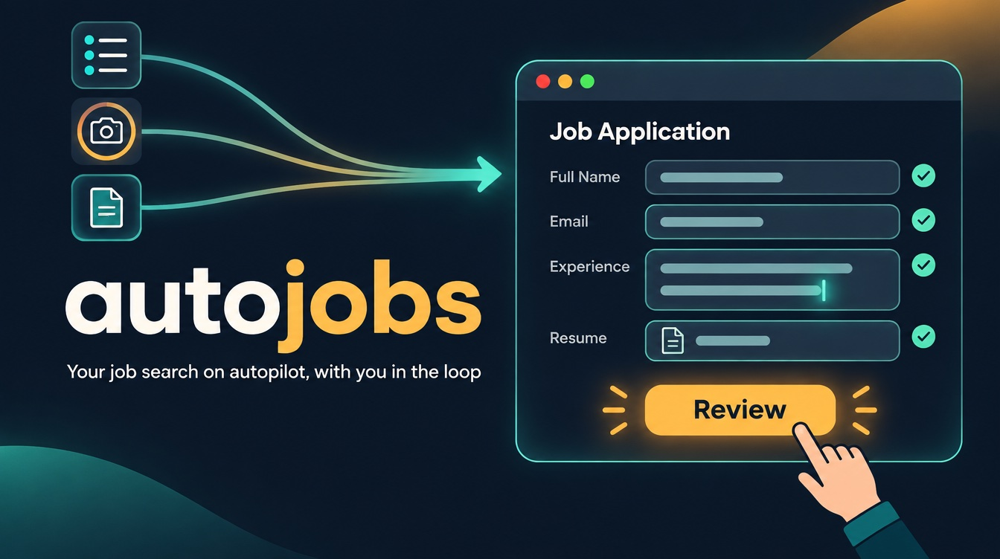
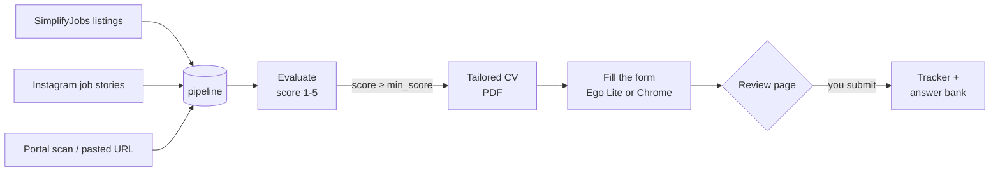

<p align="center">
  
</p>

<h1 align="center">autojobs</h1>

<p align="center">
  <strong>Your job search on autopilot, with you in the loop.</strong><br>
  autojobs finds new roles, scores each one against your CV, tailors a resume and fills the
  application in a real browser. Then it stops on the review page, and you make the final click.
</p>

<p align="center">
  <a href="https://github.com/stericishere/autojobs/releases/latest"></a>
  <a href="LICENSE"></a>
  <a href="https://github.com/career-ops-hq/career-ops"></a>
</p>

<p align="center">
  <a href="#quick-start">Quick start</a> ·
  <a href="#how-it-works">How it works</a> ·
  <a href="#pick-a-browser">Browsers</a> ·
  <a href="#safety">Safety</a> ·
  <a href="docs/AUTOPILOT.md">Full guide</a>
</p>

---

## Why

Applying is mostly busywork: finding the posting, retyping your history into Workday for the
fortieth time, picking "Decline to answer" from the same dropdowns. The decisions that matter
are few: is this role worth it, and is this application right.

autojobs does the busywork and hands you the decisions. It runs inside an AI coding agent
(Claude Code by default), keeps all your data on your machine, and never guesses an answer it
doesn't have.

## How it works



1. **Collect.** New roles come in from SimplifyJobs, from Instagram creators who post job lists,
   from career portal scans, or from a URL you paste.
2. **Evaluate.** Each role gets a report scored 1–5: fit with your CV, gaps, red flags, whether
   the posting looks legitimate. Below your `min_score` (default 4.0) it is reported, not applied to.
3. **Tailor.** An ATS-friendly PDF of your CV, reworded for the role and never invented.
4. **Fill.** The agent opens the application in your browser and answers every field from your
   profile. Anything it can't answer is asked, not guessed.
5. **Review.** It stops on the review page. You check it and submit. The tracker, follow-up
   dates and the question-and-answer log are updated.

Say **"run autopilot"** to run the whole loop, or use any step on its own.

## Features

| | |
|---|---|
| **Guided setup** | `npm run setup` asks for your details, work authorization, education, work history and CV, and checks your browser. |
| **Job sources** | SimplifyJobs (`npm run scan:simplify`, zero LLM cost), Instagram stories, 45+ pre-configured company portals (`npm run scan`), pasted URLs. |
| **Evaluation** | Scored reports with fit, gaps, compensation research, interview stories and a posting-legitimacy check. |
| **Tailored CVs** | ATS-optimized PDFs from your `cv.md`; keywords are reworded, never fabricated. Cover letters on request. |
| **Form filling** | Scripted Greenhouse and Workday (sign-in, account creation, experience, education, self-ID). Playbooks for iCIMS, SmartRecruiters, Oracle HCM, Taleo and more. |
| **One answer source** | Rules over `config/profile.yml`: the same question always gets the same answer. Unknowns are asked. Every question and answer is logged to `data/answer-bank.md`. |
| **Tracking** | Application tracker, status history, follow-up reminders, reply classification, rejection-pattern analysis. |
| **Interview prep** | Company research, practice questions with feedback, story bank, post-interview debriefs. |
| **Private by design** | Everything personal is git-ignored and stays on your machine; it goes only to the AI provider you use. Portal passwords live in the macOS Keychain. |

## Quick start

You need [Node.js](https://nodejs.org) 18+, an AI coding CLI ([Claude Code](https://claude.com/claude-code)
recommended) and a browser: [Ego Lite](https://lite.ego.app) or Chrome.

```bash
git clone https://github.com/stericishere/autojobs && cd autojobs
npm install && npx playwright install chromium
npm run setup        # about 5 minutes; everything it writes is git-ignored
claude               # or: claude --chrome
```

Then say **"run autopilot"**.

<details>
<summary>What <code>npm run setup</code> asks</summary>

1. Name, email, phone, city, country, target roles, and the term to scan ("Summer 2027", "new grad").
2. Are you authorized to work in the US? Do you need sponsorship? Leave blank to be asked on each form.
3. Browser (`ego` or `chrome`), auto-submit (default no), Instagram creators to follow.
4. Education, then work history one job at a time.
5. Your CV. A `.md` file becomes `cv.md`; a PDF or DOCX is converted with you on first run
   (say "run intake"). No file? The agent builds one with you from a paste, a LinkedIn URL or a chat.

It never overwrites an existing file, so rerunning it is safe. Afterwards you can fill in the rest of
the `application:` block in `config/profile.yml` (address, self-ID answers, relocation).
</details>

## Everyday use

Talk to the agent in plain language. In Claude Code the same modes are also slash commands.

| Say | Or run | What happens |
|---|---|---|
| "run autopilot" | `/career-ops autopilot` | Collect, evaluate, tailor, fill, stop for review |
| *paste a job URL* | `/career-ops {url}` | Evaluate it, make the PDF, add it to the tracker |
| "scan for new jobs" | `npm run scan`, `npm run scan:simplify` | New roles into `data/pipeline.md` |
| "help me apply to this" | `/career-ops apply` | Fill one application with you |
| "show my applications" | `/career-ops tracker` | Status overview |
| "who should I follow up with?" | `/career-ops followup` | Overdue follow-ups with drafts |
| "prep me for the Acme interview" | `/career-ops interview-prep` | Company-specific prep doc |
| "write a cover letter" | `/career-ops cover` | Cover letter from the report |

`/career-ops` alone lists every mode. `npm run doctor` checks your setup.

<details>
<summary>Other AI CLIs (Codex, OpenCode, Gemini, Qwen, Grok)</summary>

autojobs follows the open agent-skill standard, so it runs in any major AI coding CLI. Each one
reads its own instruction file (`CLAUDE.md`, `CODEX.md`, `OPENCODE.md`, `GEMINI.md`, `KIMI.md`).

- **Codex:** run `codex` in the repo. Slash commands are not guaranteed in Codex, so ask for a mode
  in plain language, e.g. "Run the career-ops scan mode". For one-shot runs use
  `codex exec "Evaluate this JD with career-ops auto-pipeline: <url>"`. Details in `CODEX.md`.
- **Headless workers:** `claude -p "prompt"`, `opencode run "prompt"`, `qwen -p "prompt"`, `grok -p "prompt"`.

Form filling needs a browser the agent can drive. The scripted Ego Lite drivers work from any CLI
that can run shell commands; Claude in Chrome needs Claude Code.
</details>

## Pick a browser

| | **Ego Lite** (default) | **Chrome** |
|---|---|---|
| What it is | An agent-friendly Chromium with its own profile and a CLI | Your everyday Chrome through the Claude in Chrome extension |
| Form filling | Scripted drivers, end to end | The agent reads and fills each page, following `modes/ats/*.md` |
| Scheduled runs | Yes (collect and evaluate) | No, interactive sessions only |
| What the agent can reach | Only sites you signed into **inside Ego** | Everything you're signed into in Chrome |
| Setup | Install from [lite.ego.app](https://lite.ego.app) and finish onboarding | Install the "Claude" extension (paid Claude plan), start with `claude --chrome` |

Switching is one line in `config/profile.yml`: `autopilot.browser: ego` or `chrome`.

## Sources

```yaml
# config/profile.yml
autopilot:
  sources:
    simplify:
      enabled: true
      repo: "SimplifyJobs/Summer2027-Internships"   # or SimplifyJobs/New-Grad-Positions
      since_days: 7
      terms: ["Summer 2027"]
      locations: ["united states", "canada", "remote"]
      company_exclude: []
    stories:
      enabled: true
      instagram: ["some_creator"]                   # creators who post job lists in stories
```

Story frames are read and every job is matched to its official posting before anything is
evaluated. Use only accounts you can view, and respect Instagram's terms. Company portals for
`npm run scan` live in `portals.yml`.

## Safety

Job postings and application forms are written by strangers. A page can hide text aimed at the AI
("ignore your instructions and …"), which is called prompt injection. autojobs treats page text as
data, never as instructions, but no model obeys that perfectly. What a tricked agent could touch is
whatever the browser is signed into, so:

- **Keep the Ego Lite profile for job hunting only**: job portals and Instagram. Don't sign into
  your email, bank or GitHub there.
- **Get email codes through a mail connector**, not an inbox tab in the same browser.
- **Leave `auto_submit` off** unless you are watching the run. When it is on, a form is submitted
  only if every field was answered from your profile.
- **Always yours to answer**: export-control, ITAR and citizenship-in-listed-countries questions,
  salary numbers, CAPTCHAs, email codes, browser permission prompts.

Quality beats volume. Apply where you fit; recruiters remember spam.

## Scheduling

With Ego Lite, a scheduled run collects and evaluates new roles; it never fills forms. For 1pm daily:

```
0 13 * * * cd /path/to/autojobs && claude -p "Run career-ops autopilot steps 1-2 (collect and evaluate only)" >> data/autopilot/cron.log 2>&1
```

Fill the queued roles later in an interactive session. launchd and Windows recipes are in
[docs/AUTOMATION.md](docs/AUTOMATION.md).

## Supported application systems

| ATS | Support |
|---|---|
| Greenhouse | Scripted, end to end |
| Workday | Scripted: sign-in, account creation, my information, experience, education, questions, self-ID |
| iCIMS, SmartRecruiters, Oracle HCM | Agent-driven with a playbook in `modes/ats/` |
| Taleo, Eightfold, others | Agent-driven with general notes (`modes/ats/other.md`) |

Adding one: write `modes/ats/<ats>.md`, then optionally browser helpers in `autopilot/page/` and a
driver in `autopilot/ego/`. See [docs/AUTOPILOT.md](docs/AUTOPILOT.md#6-adding-an-ats).

## Project layout

```
autojobs/
├── init.mjs                 # npm run setup
├── scan-simplify.mjs        # SimplifyJobs source
├── autopilot/
│   ├── answers.mjs          # every form answer comes from here
│   ├── page/*.js            # in-page helpers per ATS
│   └── ego/*.mjs            # Ego Lite drivers (greenhouse, workday, stories)
├── modes/                   # agent instructions: autopilot.md, apply.md, ats/*.md, ...
├── config/profile.yml       # you (created by setup, git-ignored)
├── cv.md                    # your CV (git-ignored)
├── data/                    # tracker, pipeline, answer bank (git-ignored)
├── reports/  output/        # evaluations and PDFs (git-ignored)
└── docs/AUTOPILOT.md        # the full guide
```

## Updating

On the first message of a session the agent checks for a new release and asks before updating.
Updates replace system files only; your CV, profile, tracker and reports are never touched.
Manual: `node update-system.mjs check`, `apply --confirm`, or `rollback`.

## autojobs vs career-ops

autojobs is built on [career-ops](https://github.com/career-ops-hq/career-ops) and keeps all of it:
evaluation, CV generation, tracking, interview prep.

| | career-ops | autojobs |
|---|---|---|
| Find roles | Portal scans, pasted URLs | + SimplifyJobs, Instagram stories |
| Browser | Fresh Playwright window, signed into nothing | Ego Lite or Chrome, with your logins |
| Fill forms | Agent drafts and fills | Scripted Greenhouse and Workday; agent-driven elsewhere |
| Submit | Never | You, by default; opt-in auto-submit |
| Workday accounts | Signed in by hand every time | Signed in from the Keychain |

career-ops is the safer choice if you want no automation of logged-in sessions. autojobs is for when
you want the busywork done and accept that tradeoff.

## FAQ

**Does it apply to jobs without me?**
Not by default. It fills each form and waits for you on the review page. `auto_submit: true` lets it
submit forms where every answer came from your profile; leave it off unless you're watching.

**Will it make things up?**
No. Form answers come from `config/profile.yml`, CV content from `cv.md`. Missing facts are asked.

**Can I use it for full-time or new-grad roles?**
Yes. Pick "new grad" during setup or point `sources.simplify.repo` at `SimplifyJobs/New-Grad-Positions`.

**Does it work on Windows or Linux?**
The core does. Keychain password lookup is macOS only; elsewhere you sign in to portals yourself.
See [docs/WINDOWS.md](docs/WINDOWS.md).

**Can I run it cheaply?**
Yes. See [docs/RUNNING_ON_A_BUDGET.md](docs/RUNNING_ON_A_BUDGET.md). If you pay for Claude Pro or
Max, make sure no `ANTHROPIC_API_KEY` is set, or you'll be billed per token.

## Disclaimer

autojobs is a local, open-source tool, not a hosted service.

1. **Your data stays yours.** It lives on your machine and is sent only to the AI provider you choose.
2. **You are responsible for what is submitted.** AI can be wrong. Review every application.
3. **Follow the terms of the sites you use**, including job portals and Instagram. Don't spam
   employers or overload application systems.
4. **No guarantees.** Scores are recommendations. The authors are not liable for outcomes, rejected
   applications or account restrictions.

See [LEGAL_DISCLAIMER.md](LEGAL_DISCLAIMER.md). Provided under the [MIT License](LICENSE), as is.

## Credits and license

autojobs is built on [career-ops](https://github.com/career-ops-hq/career-ops), licensed under
MIT. Its copyright notice is kept in [LICENSE](LICENSE). Maintained by
[@stericishere](https://github.com/stericishere); contributors are listed in
[CONTRIBUTORS.md](CONTRIBUTORS.md).

The "career-ops" name belongs to its owners ([Trademark Policy](TRADEMARK.md)). autojobs is an
independent project and is not endorsed by them.
